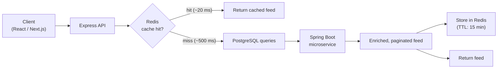

<div align="center">

# 🌐 NetworX — Professional Networking Platform

**A full-stack social networking application built to explore real-world backend and full-stack concepts: users, connections, posts, messaging, and conversations.**


</div>

---

## 📖 Overview

NetworX is a social networking application built to explore real-world backend and full-stack concepts such as users, connections, posts, messaging, and conversations. It combines a relational PostgreSQL data model, JWT/session-based authentication, a Redis caching layer for read-heavy workloads, a Java Spring Boot microservice.

This repository includes the database schema backup required to run the project locally.

## Features

- **User authentication** with sessions / JWT
- **Connections**: send connection requests, accept them, and build a network
- **Posts and comments** with a personalized, paginated feed
- **Messaging** with conversations and realtime typing indicators
- **Profiles** with About, Education, and Work sections
- **Jobs** listing and job / experience details
- **Redis caching** for feed, profile, and jobs data

## 🛠️ Tech Stack

| Layer | Technology |
|---|---|
| Frontend | React / Next.js |
| Backend | Node.js / Express |
| Database | PostgreSQL |
| Auth | Sessions / JWT |
| Microservice | Java Spring Boot |
| Caching & realtime signals | Redis (since 2 Feb 2026) |

## 🧭 Architecture: Feed Read Path



## 📸 Application Screenshots

### 🔐 Login
Secure login system for users before accessing the portal.


---

### 🏠 Landing Page
Clean and minimal landing page.


---

### 💬 Sign Up
Users enter details to create an account on the portal.


## ⚡ Redis: Caching, Realtime Signals, and Feed Acceleration

From 2 Feb 2026 onwards, Redis is used in NetworX as a high-speed, in-memory layer to reduce PostgreSQL load, accelerate feed reads, and power short-lived realtime signals without writing transient state to the database.

### Why Redis here?

- Feed generation is read-heavy and expensive to recompute (connections → posts → enrichment → pagination).
- Profile and connection data are reused across many APIs.
- Realtime UX (for example, typing indicators) should not touch the database.
- Like counts are frequently read but rarely changed.

### What we cache

| Use case | Key pattern | TTL | Purpose |
|---|---|---|---|
| Feed | `feed:connections:{user_id}:{limit}:{offset}` | 15 min | Cache the fully enriched, paginated feed (fan-out-on-read optimization) |
| User profile | `profile:{user_id}` | 5–10 min | Avoid repeated profile lookups during feed and comment rendering |
| Profile: About | `profile:about:{user_id}` | 15 min | Reused for profile viewing |
| Profile: Education | `profile:edu:{user_id}` | 15 min | Reused for profile viewing |
| Profile: Work | `profile:work:{user_id}` | 15 min | Reused for profile viewing |
| Jobs | `jobs:{user_id}:{limit}:{offset}` | 15 min | Cache the paginated jobs list |

### Performance benchmarks

| Metric | Without Redis | With Redis (cache hit) |
|---|---|---|
| Response time | ~500 ms | **~20 ms** ⚡ |
| DB queries per request | 2–3 | **0** |
| Microservice calls per request | 1 | **0** |
| Improvement | n/a | **~25x faster** |

A cache miss costs about the same as an uncached request (~500 ms) and populates the cache for subsequent requests.

### Optimizing the cache hit rate

- **Use consistent pagination:** encourage standard `limit` values (10, 20, 50).
- **Monitor cache stats:** track hit/miss ratios.
- **Adjust TTLs:** balance freshness against performance.
- **Pre-warm the cache:** cache feeds for active users during off-peak hours.

## 🗄️ Database Setup

The project ships with a PostgreSQL SQL file that defines the **entire database structure** required for the application to run.

**The SQL file contains:**

- Tables
- Columns and data types
- Primary keys and foreign keys
- Indexes
- Sequences
- Triggers and functions

> ⚠️ The file may also contain demo/sample data. This is intentional, for development convenience.

### Key tables

| Table | Description |
|---|---|
| `users` | User profiles and authentication data |
| `posts` | User posts |
| `comments` | Post comments |
| `connections` | Accepted user connections |
| `connection_requests` | Pending connection requests |
| `messages` | Chat messages |
| `conversations` | User conversations |
| `education` | Education details |
| `jobs` | Job / experience details |
| `session` | Session tracking |

## 🚀 Getting Started (Local Setup)

### Prerequisites

- Node.js
- PostgreSQL (with `psql` or pgAdmin)
- Redis and FFmpeg (for the caching and video streaming features)

### 1. Clone the repository

```bash
git clone https://github.com/amanbansal1506/NetworX.git
cd NetworX
```

### 2. Create a PostgreSQL database

```sql
CREATE DATABASE NetworX;
```

### 3. Restore the database schema

**Using `psql`:**

```bash
psql -U postgres -d NetworX -f NetworX_schema.sql
```

**Or using pgAdmin:**

1. Create an empty database named `NetworX`.
2. Right-click the database and select **Restore**.
3. Select `NetworX_schema.sql`.
4. Click **Restore**.

### 4. Configure environment variables

Create a `.env` file in the backend root:

```env
DB_HOST=localhost
DB_PORT=5432
DB_NAME=NetworX
DB_USER=postgres
DB_PASSWORD=your_password
```

### 5. Run the backend

```bash
npm install
npm run dev
```

> **Note:** The backend and the microservice have their own dedicated repositories. Clone those as well for the complete project to work. This repository will be merged with them once development is complete.

## 🧠 Notes for Contributors

- The database schema is version-controlled via SQL, not migrations.
- If you modify the schema, regenerate the SQL backup before committing.
- For production setups, consider splitting `schema.sql` and `seed.sql`.

## 📜 License

This project is for educational and learning purposes.

## 🙌 Acknowledgements

Inspired by real-world social networking platforms to practice scalable backend and database design.

## 👤 Author

**Aman Bansal**

[](https://github.com/amanbansal1506)
[](https://www.linkedin.com/in/aman-bansal-464b6a270/)
